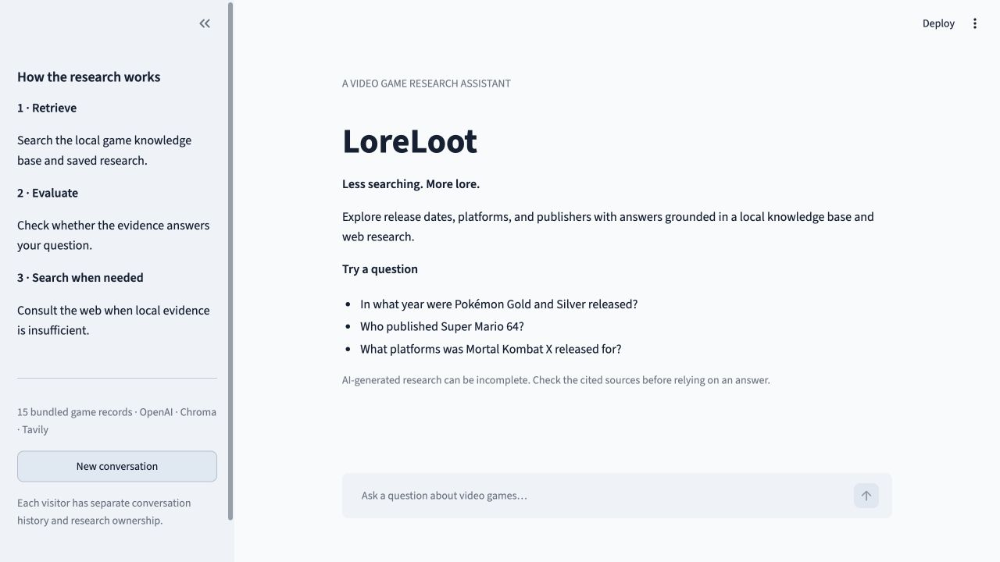

# UdaPlay

A video game research assistant with local retrieval, evidence evaluation, and web-search fallback. This standalone project wraps the existing Python agent in one Streamlit chat page.



## Run locally

Use Python 3.12 or newer from this project directory:

```sh
python -m venv .venv
source .venv/bin/activate
pip install -r requirements.txt
cp .env.example .env
# Fill in your own OpenAI and Tavily API keys in .env.
streamlit run app.py
```

The first question indexes the 15 bundled game records. Later starts reuse those records. You can index them separately with `python index_games.py`.

Keys stay on the server. `.env`, Streamlit secrets, local databases, and virtual environments are excluded from Git. Never paste a key into a notebook or commit it.

## Project layout

- `app.py`: the chat interface and its inline one-shot prompt.
- `index_games.py`: loads the JSON dataset into Chroma without duplicating IDs.
- `lib/`: the existing agent, state machine, tools, and memory code.
- `games/`: the bundled dataset.
- `notebooks/`: the original coursework notebooks, retained for reference. Run the original notebooks from the original coursework folder; the web app does not require Jupyter.

The agent follows the existing workflow: retrieve → evaluate → web search if needed → evaluate → answer. The interface exposes the actual executed steps. This is an educational prototype; citations and model judgments still need human verification.

Conversation state belongs to each Streamlit browser session. Research storage is filtered by a separate visitor identifier. Resetting or losing a browser session creates a new identifier, so prior visitors' research is not exposed to a new visitor. The library's default owner remains `udaplay` for notebook use.

## Source repository

The standalone source is published at [horpeazy/udaplay](https://github.com/horpeazy/udaplay).
It is separate from the original Udacity coursework repository.

```sh
git clone https://github.com/horpeazy/udaplay.git
cd udaplay
```

Before committing changes, inspect `git status` and verify that `.env`, Streamlit
secrets, and generated databases are not included.

## Deployment and portfolio

The app requires a Python server. The simplest portfolio integration is a link to the running demo. An existing portfolio can also embed it if the portfolio and hosting settings permit framing.

### Streamlit Community Cloud

Connect your own GitHub repository and select `app.py` as the entrypoint. Select Python 3.12 or newer. Add server secrets in the deployment settings; never commit a real `.streamlit/secrets.toml` file:

```toml
OPENAI_API_KEY = "your-key"
TAVILY_API_KEY = "your-key"
OPENAI_BASE_URL = "https://api.openai.com/v1"
```

Root-level Streamlit secrets are exposed as environment variables. Initial indexing calls the embedding API. Research questions can call OpenAI and Tavily using the configured accounts. The server also limits research to five requests per minute and 100 per UTC day across visitors in one app process; resetting a conversation does not reset this shared quota. Process restarts reset these in-memory counters, so configure provider-side budgets as the billing backstop. The browser additionally limits each conversation to ten turns.

### Docker / Python hosting

```sh
docker build -t udaplay .
docker run --rm -p 8501:8501 --env-file .env -e UDAPLAY_DATA_DIR=/data -v udaplay-data:/data udaplay
```

For a host with a persistent disk, set `UDAPLAY_DATA_DIR` to its mounted path. For example, a Render service with a disk mounted at `/var/data` can use `UDAPLAY_DATA_DIR=/var/data`. A persistent client writes to disk, but cannot preserve data if the host discards that disk. Do not claim that research survives deployment restarts unless persistent storage is configured.

Deployment has not been performed. Streamlit Community Cloud is the initial deployment target; its demo URL can be linked from a future portfolio.

## Attribution and publication rights

This project includes modified educational starter code and game data from [Udacity's Building Agents repository](https://github.com/udacity/cd14524-building-agents-public). The upstream `LICENSE.md` is preserved. It includes CC BY-NC-ND terms. The project owner has confirmed permission to publish this modified course project. No new license is asserted over Udacity's code.
